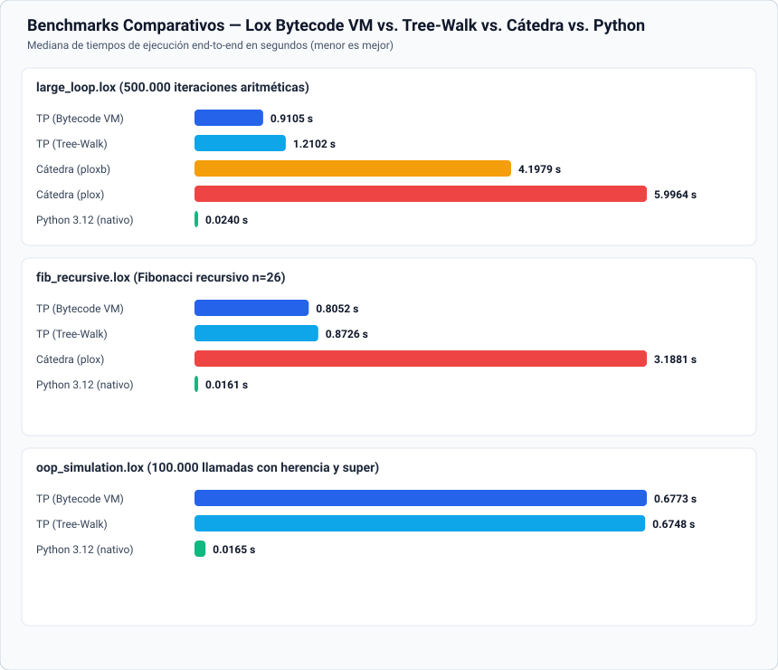

# Intérprete Tree-Walk y Máquina Virtual de Bytecode para Lox

Trabajo Práctico Final de **Lenguajes y Compiladores — FIUBA**.

El proyecto implementa en **Python 3.12** un entorno de ejecución completo y dual para el lenguaje **Lox**: cuenta tanto con el intérprete **Tree-Walk** desarrollado en la primera etapa como con un **Compilador a Bytecode y una Máquina Virtual de Pila (*Stack-based Bytecode VM*)**, soporte completo para **Programación Orientada a Objetos (OOP)**, operadores extendidos (`+=`, `-=`, `*=`, `/=`, `**`), un caso de uso integral y una suite de benchmarks comparativos.

Jiangjie Chen - 109747

---

## Qué hace el TP

El lenguaje y su entorno soportan:

- **Tipos de datos:** números (`float`), cadenas (`str`), booleanos (` true` / `false`) y `nil`.
- **Operadores básicos y extendidos ("Un alguito extra"):**
  - Aritméticos (`+`, `-`, `*`, `/`, `%`), comparación (`<`, `<=`, `>`, `>=`, `==`, `!=`) y lógicos con cortocircuito (`and`, `or`, `!`).
  - **Potencia (`**`)** asociativa a derecha (`2 ** 3 ** 2 == 512`).
  - **Asignación compuesta (`+=`, `-=`, `*=`, `/=`)** tanto sobre variables locales/globales/upvalues como sobre propiedades de objetos (`inst.x += 5`).
- **Variables y ámbitos:** declaración (`var`), lectura, asignación, bloques `{ ... }` con ámbitos léxicos anidados y *shadowing*.
- **Control de flujo:** sentencias condicionales (`if` / `else`) y bucles (`while` y `for`).
- **Funciones de primera clase y *closures*:** declaración (`fun`), recursión, funciones anidadas y captura de variables libres mediante *upvalues*.
- **Programación Orientada a Objetos (OOP):**
  - Declaración de clases (`class`), instanciación mediante llamada (`Clase()`), lectura y escritura dinámica de propiedades (`obj.prop`, `obj.prop = val`).
  - Métodos, constructores (`init`), ligadura léxica de `this`, herencia simple (`class Sub < Super`) y despacho a métodos de la superclase (`super.metodo(...)`).
- **Doble motor de ejecución e inspección:**
  - **Máquina Virtual de Bytecode (`--vm`, por defecto):** compila el AST a un `Chunk` de instrucciones binarias y lo ejecuta sobre una pila de valores y `CallFrame`s.
  - **Intérprete Tree-Walk (`--tree-walk`):** resuelve estáticamente alcances con `Resolver` y evalúa recursivamente el AST.
  - **Herramientas de inspección:** visualización de tokens (`--scanner`), árbol sintáctico (`--ast`) y desensamblado del bytecode (`--bytecode`).

---

## Pipeline de ejecución

El proyecto comparte el *frontend* léxico y sintáctico (`Scanner` $\rightarrow$ `Parser` $\rightarrow$ `AST`) entre ambos motores de ejecución:

```mermaid
flowchart LR
    Source["Código fuente .lox"] --> Scanner["Scanner"]
    Scanner --> Tokens["Tokens"]
    Tokens --> Parser["Parser"]
    Parser --> AST["AST"]

    AST -->|--vm (por defecto)| Compiler["BytecodeCompiler"]
    Compiler --> Chunk["Chunk (Bytecode + Constantes)"]
    Chunk --> VM["VirtualMachine (Stack + CallFrames)"]
    VM --> Output["Salida o error"]

    AST -->|--tree-walk| Resolver["Resolver"]
    Resolver --> Interpreter["Interpreter (Tree-Walk)"]
    Interpreter --> Output
```

### 1. Scanner y Token

[`scanner.py`](src/lox/syntax/scanner.py) recorre el código carácter por carácter y genera objetos inmutables definidos en [`token.py`](src/lox/syntax/token.py):

```python
@dataclass(frozen=True)
class Token:
    token_type: TokenType
    lexeme: str
    literal: Any = None
    line: int = 1
```

El scanner guarda el comienzo del lexema en `start` y la posición actual en `current`. En `scan_token()` reconoce símbolos simples y compuestos (incluyendo `**`, `+=`, `-=`, `*=`, `/=`), literales numéricos, cadenas, identificadores y palabras reservadas (`class`, `super`, `this`, `fun`, `var`, etc.):

```python
c = self._advance()

match c:
    case "+":
        token_type = TokenType.PLUS_EQUAL if self._match("=") else TokenType.PLUS
        self._add_token(token_type)
    case "*":
        if self._match("*"):
            self._add_token(TokenType.STAR_STAR)
        elif self._match("="):
            self._add_token(TokenType.STAR_EQUAL)
        else:
            self._add_token(TokenType.STAR)
```

### 2. Parser y Desazucarado Sintáctico

[`parser.py`](src/lox/syntax/parser.py) recibe la lista de tokens y construye el AST mediante **descenso recursivo** respetando la jerarquía de precedencia:

$$\text{assignment} \to \text{or} \to \text{and} \to \text{equality} \to \text{comparison} \to \text{term} \to \text{factor} \to \text{unary} \to \text{power} \to \text{call/get} \to \text{primary}$$

- **Potencia asociativa a derecha (`_power`):** A diferencia de `+`, `-`, `*` y `/` que usan bucles `while` (asociatividad a izquierda), `_power()` se invoca recursivamente para el operando derecho, de modo que `2 ** 3 ** 2` se agrupa como `2 ** (3 ** 2) = 512`:

```python
def _power(self) -> Expr:
    expr = self._call()
    if self._match(TokenType.STAR_STAR):
        operator = self._previous()
        right = self._unary()
        return BinaryExpr(left=expr, operator=operator, right=right)
    return expr
```

- **Accesos encadenados y llamadas (`_call`):** Intercala llamadas `(...)` y accesos con punto `.prop` en un mismo bucle, permitiendo expresiones como ` fabrica.crear().configurar().valor = 10 `.
- **Asignación simple y compuesta (`_assignment`):** Verifica que el lado izquierdo sea un destino válido (`VariableExpr` o `GetExpr`). Si el operador es compuesto (`+=`, `-=`, `*=`, `/=`), lo desazucara sintácticamente construyendo un `BinaryExpr` con el operador aritmético correspondiente dentro de un `AssignmentExpr` o `SetExpr`.

### 3. AST

[`ast.py`](src/lox/syntax/ast.py) define nodos inmutables (`@dataclass(frozen=True)`) para expresiones y sentencias. Además de los nodos básicos (`BinaryExpr`, `UnaryExpr`, `LiteralExpr`, `VariableExpr`, `AssignmentExpr`, `CallExpr`, `IfStmt`, `WhileStmt`, `FunDecl`, etc.), incorpora los nodos de Programación Orientada a Objetos:

- `ClassDecl(name: Token, superclass: Optional[VariableExpr], methods: list[FunDecl])`
- `GetExpr(object: Expr, name: Token)` — lectura de propiedad o método (`obj.prop`)
- `SetExpr(object: Expr, name: Token, value: Expr)` — escritura de campo (`obj.prop = val`)
- `ThisExpr(keyword: Token)` — referencia al receptor `this`
- `SuperExpr(keyword: Token, method: Token)` — acceso a método de la superclase (`super.metodo`)

### 4. Motor Tree-Walk: Resolver e Interpreter

Cuando se ejecuta con `--tree-walk`, el AST pasa primero por [`resolver.py`](src/lox/semantics/resolver.py) y luego por [`interpreter.py`](src/lox/runtime/interpreter.py):

- **`Resolver`:** Calcula estáticamente la distancia léxica (`depth`) de cada variable local, `this` y `super`, registrándola en `interpreter.resolve(expr, depth)` usando `id(expr)` como clave. Además valida errores semánticos en tiempo de compilación:
  - Uso de `this` fuera de un método de clase.
  - Uso de `super` fuera de una clase o en una clase que no tiene superclase.
  - Herencia circular directa (`class A < A {}`).
  - `return <valor>;` con valor explícito en un inicializador `init` (mientras que `return;` vacío sí se permite y devuelve `this`).
  - `return` en el nivel superior fuera de toda función.
- **`Interpreter`, `LoxClass` y `LoxInstance`:** En [`callable.py`](src/lox/runtime/callable.py), `LoxClass` actúa como un `LoxCallable` que al invocarse crea una `LoxInstance` y, si existe el método `init`, lo liga (`bind`) y ejecuta. `LoxInstance.get()` busca primero en el diccionario `fields` de la instancia (priorizando campos sobre métodos, *shadowing*) y luego en la cadena de `methods` de la clase y sus superclases.

### 5. Motor Bytecode: Compilador y Máquina Virtual (`src/lox/bytecode/`)

Por defecto (`--vm`), el proyecto utiliza el backend de compilación a bytecode y ejecución en Máquina Virtual de Pila:

#### 5.1. Representación del Bytecode (`chunk.py`)

[`chunk.py`](src/lox/bytecode/chunk.py) define el conjunto de instrucciones `OpCode(IntEnum)` y la estructura `Chunk`:

- `code: bytearray`: secuencia contigua de bytes con opcodes y sus operandos.
- `constants: list[Any]`: pool de constantes (literales numéricos, strings, nombres de identificadores y objetos `ObjFunction`).
- `lines: list[int]`: número de línea de origen paralelo a cada byte de `code` para reportar diagnósticos precisos en errores de runtime.

Las instrucciones se dividen en:
- **Sin operandos (1 byte):** `OP_NIL`, `OP_TRUE`, `OP_FALSE`, `OP_POP`, `OP_ADD`, `OP_SUBTRACT`, `OP_MULTIPLY`, `OP_DIVIDE`, `OP_MODULO`, `OP_POWER`, `OP_NEGATE`, `OP_NOT`, `OP_EQUAL`, `OP_BANG_EQUAL`, `OP_GREATER`, `OP_GREATER_EQUAL`, `OP_LESS`, `OP_LESS_EQUAL`, `OP_PRINT`, `OP_RETURN`, `OP_CLOSE_UPVALUE`, `OP_INHERIT`.
- **Con índice de constante (2 bytes: opcode + `const_idx`):** `OP_CONSTANT`, `OP_DEFINE_GLOBAL`, `OP_GET_GLOBAL`, `OP_SET_GLOBAL`, `OP_CLASS`, `OP_METHOD`, `OP_GET_PROPERTY`, `OP_SET_PROPERTY`, `OP_GET_SUPER`.
- **Con índice de slot o cantidad de argumentos (2 bytes: opcode + `slot`/`argc`):** `OP_GET_LOCAL`, `OP_SET_LOCAL`, `OP_GET_UPVALUE`, `OP_SET_UPVALUE`, `OP_CALL`.
- **Superinstrucciones de invocación directa (3 bytes: opcode + `const_idx` + `argc`):** `OP_INVOKE`, `OP_SUPER_INVOKE`.
- **Saltos con offset de 16 bits big-endian (3 bytes):** `OP_JUMP`, `OP_JUMP_IF_FALSE`, `OP_LOOP`.
- **Clausuras de longitud variable:** `OP_CLOSURE <const_idx>` seguido de pares `(is_local, index)` por cada upvalue capturado.

#### 5.2. Compilador a Bytecode (`compiler.py`)

[`compiler.py`](src/lox/bytecode/compiler.py) implementa `BytecodeCompiler(ExprVisitor, StmtVisitor)`, que traduce el AST manteniendo un **invariante estricto sobre el stack de la VM**:

1. **Toda expresión (`Expr`)** tiene un efecto neto de **`+1`** sobre el stack (empuja exactamente su valor resultante).
2. **Toda sentencia (`Stmt`)** tiene un efecto neto de **`0`** sobre el stack (deja la altura del stack igual que antes de ejecutarse, salvo declaraciones de variables locales que ocupan su propio slot dentro del ámbito activo).

- **Simulación estática del stack para variables locales:** `CompilerState` mantiene una lista `locals: list[LocalSlot]` que espeja en tiempo de compilación la disposición exacta de la ventana del `CallFrame` en ejecución. El slot `0` de cada `CallFrame` se reserva para `this` (en métodos e inicializadores) o `""` (en funciones normales y el script). Así, leer o escribir una variable local no busca por nombre en ningún diccionario: emite `OP_GET_LOCAL <slot>` u `OP_SET_LOCAL <slot>`, que indexan directamente `stack[base_slot + slot]` en $O(1)$.
- **Backpatching de saltos:** En `if/else`, `and` y `or`, `_emit_jump()` emite la instrucción de salto con dos bytes `0xFF 0xFF` provisorios y luego `_patch_jump()` escribe la distancia exacta en 16 bits big-endian una vez compilado el bloque intermedio.
- **Resolución de *Upvalues* y salida de bloque:** Cuando una función interna referencia una variable local de una función envolvente, `_resolve_upvalue()` registra un `UpvalueSlot` y marca el `LocalSlot` original con `is_captured = True`. Al cerrar el bloque (`_end_scope`), si una variable local fue capturada por un closure, en lugar de `OP_POP` se emite `OP_CLOSE_UPVALUE` para migrar su valor del stack al heap.

#### 5.3. Máquina Virtual (`vm.py` y `objects.py`)

[`vm.py`](src/lox/bytecode/vm.py) ejecuta el ciclo *Fetch-Decode-Execute* manteniendo:

- `stack: list[Any]`: pila unificada de valores y variables locales.
- `frames: list[CallFrame]`: pila de marcos de activación; cada `CallFrame` almacena su `closure: ObjClosure`, su puntero de instrucción `ip: int` y el desplazamiento `base_slot: int` donde comienza su ventana en `stack`.
- `globals: dict[str, Any]`: tabla de variables globales y funciones nativas (`clock`).
- `open_upvalues: list[ObjUpvalue]`: lista ordenada de *upvalues* abiertos que aún apuntan a índices vivos del stack (`location`). Cuando el `CallFrame` retorna o se ejecuta `OP_CLOSE_UPVALUE`, `_close_upvalues()` copia el valor del stack a `upvalue.closed` y pone `location = None`.
- **Optimización con `OP_INVOKE` y `OP_SUPER_INVOKE`:** Cuando el compilador detecta que un acceso a propiedad o a `super` es inmediatamente invocado (`inst.metodo(a, b)` o `super.metodo(a, b)`), emite `OP_INVOKE` u `OP_SUPER_INVOKE` en lugar de `OP_GET_PROPERTY` + `OP_CALL`. Esto evita instanciar un objeto intermedio `ObjBoundMethod` en el heap en cada llamada.

---

## Caso de uso complejo: Arena y Ladder de Clash Royale (`examples/clash_royale.lox`)

En [`examples/clash_royale.lox`](examples/clash_royale.lox) se implementó un simulador completo en Lox ambientado en **Clash Royale** que ejercita todas las características del lenguaje:

1. **Jerarquía de clases de 3 niveles y polimorfismo (`<`, `super`, `this`, `init`):**
   - `Carta` (clase base con nombre, costo de elixir, vida, daño base y estado en arena) $\rightarrow$ `TropaTerrestre < Carta` (agrega armadura de escudo que absorbe daño parcial y golpe crítico usando `super.atacar_objetivo`) $\rightarrow$ `CampeonReal < TropaTerrestre` (agrega habilidad especial con costo de elixir y *scaling* exponencial con `**`).
   - `TropaInfernal < Carta` (Dragón Infernal cuyo rayo térmico escala exponencialmente en etapas de calor usando `2 ** this.etapa_calor`).
2. **Closures con estado privado:** `crear_rng(semilla)` implementa un generador pseudoaleatorio congruencial lineal (LCG) que captura `estado` en un upvalue.
3. **Estructuras de datos dinámicas y funciones de orden superior:**
   - `ListaTVRoyale` y `NodoEvento`: lista enlazada con métodos de orden superior `recorrer(fn)` y `reducir(inicial, fn)` que reciben funciones/closures como callbacks.
   - `LadderTrofeosBST` y `NodoJugador`: Árbol Binario de Búsqueda (BST) recursivo que ordena a los jugadores del clan por copas y los imprime de menor a mayor mediante recorrido *in-order*.
4. **Uso intensivo de los operadores extra (`+=`, `-=`, `*=`, `/=`, `**`):** tanto en acumuladores locales como sobre propiedades de instancias (`this.vida -= dano`, `this.etapa_calor += 1`, `2 ** this.etapa_calor`).

Se puede ejecutar con cualquiera de los dos motores o inspeccionar su bytecode:

```bash
uv run pylox examples/clash_royale.lox
uv run pylox --tree-walk examples/clash_royale.lox
uv run pylox --bytecode examples/clash_royale.lox
```

---

## Estructura del proyecto

```text
LyC-TP/
├── src/lox/
│   ├── syntax/
│   │   ├── token.py          # TokenType (incluye +=, -=, *=, /=, **) y dataclass Token
│   │   ├── scanner.py        # Análisis léxico
│   │   ├── ast.py            # Nodos del AST, Visitor y AstPrinter
│   │   └── parser.py         # Parser recursivo descendente y desazucarado
│   ├── semantics/
│   │   └── resolver.py       # Resolución estática de alcances y validaciones OOP
│   ├── runtime/
│   │   ├── environment.py    # Entornos léxicos del intérprete Tree-Walk
│   │   ├── callable.py       # LoxCallable, LoxFunction, LoxClass, LoxInstance
│   │   └── interpreter.py    # Intérprete Tree-Walk
│   ├── bytecode/
│   │   ├── chunk.py          # OpCode, Chunk y desensamblador de bytecode
│   │   ├── objects.py        # ObjFunction, ObjClosure, ObjUpvalue, ObjClass, CallFrame
│   │   ├── compiler.py       # Compilador AST -> Bytecode Chunk
│   │   └── vm.py             # Máquina Virtual de Pila (Stack-based VM)
│   ├── errors.py             # Jerarquía de errores y DiagnosticReporter
│   └── cli.py                # CLI (--vm, --tree-walk, --bytecode, --ast, --scanner)
├── examples/
│   └── clash_royale.lox      # Caso de uso complejo en Lox
├── tests/                    # 145 tests (unitarios, OOP, VM, features extra y real_tests)
├── benches/
│   ├── benchmark.py          # Suite comparativa de benchmarks y generador de SVG
│   ├── compare_loop.py       # Comparación puntual sobre large_loop.lox
│   ├── benchmark_results.svg # Gráfico comparativo de tiempos de ejecución
│   └── programs/             # large_loop.lox, fib_recursive.lox, oop_simulation.lox
└── pyproject.toml
```

---

## Instalación y uso

Requisitos:
- Python 3.12 o superior.
- [`uv`](https://docs.astral.sh/uv/).

Instalar el proyecto y sus dependencias desde `LyC-TP`:

```bash
cd LyC-TP
uv sync
```

Ejecutar un archivo con la Máquina Virtual de Bytecode (modo por defecto):

```bash
uv run pylox examples/clash_royale.lox
```

Ejecutar un archivo con el intérprete Tree-Walk:

```bash
uv run pylox --tree-walk examples/clash_royale.lox
```

Inspeccionar el bytecode desensamblado (`Chunk` principal y funciones/métodos compilados):

```bash
uv run pylox --bytecode examples/clash_royale.lox
```

Inspeccionar los tokens o el AST:

```bash
uv run pylox --scanner examples/clash_royale.lox
uv run pylox --ast examples/clash_royale.lox
```

Abrir el REPL interactivo:

```bash
uv run pylox
```

---

## ¿Cómo se diferencia de lo que hicimos en clase?

A lo largo de la materia trabajamos con dos implementaciones de referencia provistas por la cátedra: **`plox`** (intérprete Tree-Walk) y **`ploxb`** (compilador a bytecode y Máquina Virtual). Nuestro TP presenta diferencias arquitectónicas y de diseño concretas frente a ambas:

### 1. Compilador de una sola pasada (Pratt Parser en `ploxb`) vs. Pipeline con AST intermedio (TP)

- **En clase (`ploxb`):** El compilador de `ploxb` utiliza un **Pratt Parser de una sola pasada** (`Tokens` $\rightarrow$ `Chunk`), guiado por una tabla de precedencias `PRATT` que emite bytecode directamente a medida que consume tokens, sin construir un árbol sintáctico en memoria:

```python
# Cátedra (ploxb/Compiler.py)
PRATT: dict[TokenType, tuple[str | None, str | None, Precedence, Precedence]] = {
    TokenType.MINUS: ("unary", "binary", Precedence.PREC_UNARY, Precedence.PREC_TERM),
    TokenType.PLUS:  (None,    "binary", Precedence.PREC_NONE,  Precedence.PREC_TERM),
    ...
}
```

- **En el TP (`src/lox/bytecode/compiler.py`):** Como ya contábamos con un *frontend* completo y testeado (`Scanner` $\rightarrow$ `Parser` $\rightarrow$ `AST`), diseñamos [`BytecodeCompiler`](src/lox/bytecode/compiler.py) como un **visitante sobre el AST** (`AST` $\rightarrow$ `Chunk`).
  - **Ventaja práctica:** Nos permitió reutilizar el 100% del `Scanner`, del `Parser` y de todas las transformaciones sintácticas (como el desazucarado de `for` en `while` y de los operadores compuestos `+=`, `-=`, `*=`, `/=`) tanto para el intérprete Tree-Walk (`--tree-walk`) como para la Máquina Virtual (`--vm`) y el impresor `--ast`, garantizando que ambos motores reciban exactamente la misma estructura sintáctica.

### 2. Ciclo de ejecución de la VM (`ploxb` vs. TP)

- **En clase (`ploxb/VM.py`):** El método `run()` de `ploxb` prioriza la didáctica y la trazabilidad paso a paso: en cada iteración del bucle principal construye un string formateado `debug_prefix = f"{self.ip:04d}"` (incluso cuando `debug=False`), invoca funciones auxiliares (`READ()`, `self.pop()`, `self.push()`, `self.peek()`) y valida tipos mediante `self.is_number(a, b)` usando `*values` y comprensiones:

```python
# Cátedra (ploxb/VM.py)
while self.ip < len(chunk.bytes):
    debug_prefix = f"{self.ip:04d}"
    byte = READ()
    match byte:
        case OpCode.OP_ADD:
            b, a = self.pop(), self.pop()
            if not self.is_number(a, b) and not self.is_string(a, b):
                raise RuntimeError(...)
            self.push(a + b)
```

- **En el TP (`src/lox/bytecode/vm.py`):** En [`VirtualMachine._execute()`](src/lox/bytecode/vm.py) optimizamos el camino crítico de despacho:
  1. Cacheamos en variables locales de la función `_execute` las referencias más accedidas del frame activo (`code`, `constants`, `ip`, `base_slot`, `stack`, `push = stack.append`, `pop = stack.pop`), evitando decenas de millones de búsquedas de atributos (`self.stack`, `self.ip`) en Python.
  2. Usamos *fast-paths* para operaciones aritméticas y de comparación (`ta is float or ta is int`), evitando llamadas a métodos de validación en el caso común.
  3. Separamos completamente el desensamblador (`Chunk.disassemble()`) del bucle de ejecución de la VM, eliminando el formateo de strings en tiempo de corrida.
  4. Como resultado, en el benchmark `large_loop.lox` la VM del TP es **4,61x más rápida que `ploxb`** (`0,91 s` vs. `4,20 s`).

### 3. Alcance del lenguaje en Bytecode: CallFrames, Upvalues cerrados y OOP con `OP_INVOKE`

- Mientras que `ploxb` en su rama principal modela un único `ip` global y en su rama de funciones introduce `CallFrame`s y clausuras, nuestra VM integra en un único motor:
  - Pila de `CallFrame`s con ventanas deslizantes (`base_slot`).
  - Lista enlazada ordenada de `open_upvalues` que se cierran automáticamente al salir de un bloque (`OP_CLOSE_UPVALUE`) o al retornar de una función (`OP_RETURN`).
  - Soporte completo para **Programación Orientada a Objetos en bytecode**: clases (`OP_CLASS`), métodos (`OP_METHOD`), herencia por copia de tabla de métodos (`OP_INHERIT`), campos (`OP_GET_PROPERTY`, `OP_SET_PROPERTY`), `super` (`OP_GET_SUPER`, capturado como upvalue en un ámbito léxico oculto) y las superinstrucciones de optimización **`OP_INVOKE`** y **`OP_SUPER_INVOKE`**.

### 4. Despacho en el motor Tree-Walk (`singledispatchmethod` vs. Patrón Visitor e `id(expr)`)

Respecto al intérprete Tree-Walk (`plox` de la cátedra vs. nuestro `Interpreter`):
- **Nodos del AST y distancias léxicas:** La cátedra define clases mutables y usa el nodo como clave en `self.local_scope_depths[expression] = depth`. En el TP usamos `@dataclass(frozen=True)` (que genera igualdad estructural por valor) y por eso indexamos las resoluciones con `self.locals[id(expr)] = depth`, asegurando que dos expresiones sintácticamente idénticas en distintas líneas no colisionen.
- **Mecanismo de despacho:** `plox` utiliza `@singledispatchmethod`, que inspecciona dinámicamente el tipo del nodo en cada evaluación, mientras que el TP aplica el **patrón Visitor** (`expr.accept(self)` $\rightarrow$ `visit_binary_expr`), logrando una llamada directa que hace que incluso nuestro intérprete Tree-Walk sea ~5x más rápido que `plox`.
- **Manejo de errores y recuperación:** `plox` y `ploxb` abortan ante el primer error lanzando excepciones nativas (`SyntaxError`, `RuntimeError`). El TP centraliza los diagnósticos en `DiagnosticReporter`, incluye sincronización en modo pánico (`_synchronize()`) en el parser para reportar múltiples errores sintácticos en una sola corrida, mantiene el historial de líneas en `Chunk.lines` para reportar la línea exacta en errores de bytecode, y respeta los códigos de salida estándar (`65` para error de compilación y `70` para error de runtime).

---

## ¿El lenguaje de la implementación (Python) nos cambió alguna idea?

Implementar tanto un intérprete Tree-Walk como un compilador a Bytecode y su Máquina Virtual usando **Python** (en lugar de un lenguaje compilado a código nativo como C en el `clox` de *Crafting Interpreters* o Rust/C++) nos cambió varias ideas preconcebidas sobre cómo funciona un runtime por dentro:

1. **El efecto de la "Doble Interpretación" (*Double Interpretation Overhead*):**
   Antes de hacer el TP, la intuición era que pasar de un intérprete Tree-Walk a una Máquina Virtual de Bytecode iba a multiplicar la velocidad por 10x o 20x automáticamente. Al implementarlo en Python descubrimos que nuestro bucle `while True: match byte:` dentro de `VirtualMachine._execute()` **está siendo interpretado a su vez por la Máquina Virtual en C de CPython** (`_PyEval_EvalFrameDefault`). Es decir, por cada opcode de Lox que decodificamos, CPython ejecuta decenas de sus propios bytecodes en C. Esto nos enseñó que en un lenguaje anfitrión interpretado el cuello de botella principal no es solo recorrer el árbol vs. leer un `bytearray`, sino **la cantidad de operaciones y llamadas a funciones del lenguaje anfitrión que ejecutamos por cada instrucción de Lox**.
2. **Importancia de los detalles de bajo nivel de Python en el loop de la VM:**
   Nos sorprendió cuánto impactan micro-decisiones de Python dentro del ciclo *fetch-decode-execute*. En nuestra primera versión de la VM, hacer `self.stack.append(...)`, `self.stack.pop()` y `self.frames[-1].ip` en cada opcode hacía que el bucle aritmético tardara `2,23 s`. Simplemente cachear las referencias calientes en variables locales de la función (`stack = self.stack`, `push = stack.append`, `pop = stack.pop`, `code`, `ip`, `base_slot`) —lo que en CPython reemplaza búsquedas en diccionarios de atributos (`LOAD_ATTR`) por accesos a arreglos locales (`LOAD_FAST`)— redujo el tiempo a **`0,91 s` (más de 2,4x de mejora)** y permitió superar ampliamente al Tree-Walk.
3. **Representación de valores y localidad de memoria:**
   En C (`clox`), un `Chunk` de bytes y un `Value[]` en el stack aprovechan al máximo la caché L1/L2 del procesador porque los valores son structs compactos (`NaN-boxing` o *tagged unions* de 8/16 bytes) contiguos en memoria. En Python, si bien `Chunk.code` sí es un `bytearray` contiguo real en memoria, el `stack: list[Any]` almacena punteros `PyObject*` a objetos boxeados en el heap de Python (`float`, `bool`, `str`). Entender esto nos permitió comprender por qué Python 3.12 nativo tarda `0,024 s` en el mismo bucle: su bucle corre directamente en C mientras que nuestra VM paga el costo de despachar en Python.
4. **El Garbage Collector del lenguaje anfitrión como ventaja y como límite:**
   Por un lado, apoyarnos en el conteo de referencias y el recolector de basura cíclico de Python nos simplificó enormemente la gestión de memoria (no tuvimos que programar un *Mark-and-Sweep GC* manual como en C). Sin embargo, al medir el benchmark de objetos (`oop_simulation.lox`), notamos que crear un objeto `ObjBoundMethod` nuevo en cada llamada `inst.step(i)` generaba cientos de miles de alocaciones efímeras en el heap de Python. Eso nos llevó a valorar e implementar las superinstrucciones `OP_INVOKE` y `OP_SUPER_INVOKE`, que fusionan la búsqueda del método y la llamada sin alocar ningún objeto intermedio.
5. **Expresividad para diseñar el compilador:**
   Finalmente, usar Python 3.12 con `@dataclass(frozen=True)`, `IntEnum` y *pattern matching* estructural (`match / case`) hizo que escribir el compilador, el desensamblador y el manejador de opcodes fuera mucho más claro, declarativo y menos propenso a bugs de memoria que en C, permitiéndonos concentrarnos en los invariantes de pila, el *backpatching* de saltos y la semántica de los *upvalues*.

---

## Benchmarks y Análisis de Performance

La suite [`benches/benchmark.py`](benches/benchmark.py) evalúa de punta a punta (incluyendo arranque del proceso, escaneo, parseo, compilación/resolución y ejecución) tres cargas de trabajo representativas:

1. **[`large_loop.lox`](benches/programs/large_loop.lox):** Bucle intensivo de 500.000 iteraciones aritméticas (`sum = sum + (i % 7)`). Evalúa el costo puro del ciclo *fetch-decode-execute*, saltos (`OP_LOOP`, `OP_JUMP_IF_FALSE`) y acceso a variables.
2. **[`fib_recursive.lox`](benches/programs/fib_recursive.lox):** Cálculo recursivo de `fib(26)` (392.835 llamadas recursivas). Evalúa el costo de creación y destrucción de `CallFrame`s (`OP_CALL` y `OP_RETURN`) frente a la creación de `Environment`s en el Tree-Walk.
3. **[`oop_simulation.lox`](benches/programs/oop_simulation.lox):** 100.000 iteraciones invocando métodos polimórficos con herencia (`Troop < Entity`), lectura/escritura de propiedades (`this.hp`, `this.energy`) y llamadas a la superclase (`super.step(dt)`).

En todas las pruebas se realiza 1 corrida previa de calentamiento (*warmup*) descartada y luego se miden las corridas verificando que la salida numérica coincida exactamente con el valor esperado.

### Gráfico Comparativo



### Tablas de Resultados

#### 1. `large_loop.lox` (500.000 iteraciones aritméticas)

| Implementación | Mediana (s) | Promedio (s) | Mínimo (s) | Tiempo relativo vs. TP VM |
|---|---:|---:|---:|---:|
| **TP (Bytecode VM)** | **0,9105** | 0,9078 | 0,9022 | **1,00x (base)** |
| **TP (Tree-Walk)** | 1,2102 | 1,2114 | 1,2068 | 1,33x *(la VM del TP es **1,33x más rápida**)* |
| **Cátedra (`ploxb`)** | 4,1979 | 4,2198 | 4,1070 | 4,61x *(la VM del TP es **4,61x más rápida**)* |
| **Cátedra (`plox`)** | 5,9964 | 5,9992 | 5,9680 | 6,59x *(la VM del TP es **6,59x más rápida**)* |
| **Python 3.12 (nativo)** | 0,0240 | 0,0241 | 0,0232 | 0,03x *(~38x más rápido que la VM en Python)* |

#### 2. `fib_recursive.lox` (Fibonacci recursivo `n=26`)

| Implementación | Mediana (s) | Promedio (s) | Mínimo (s) | Tiempo relativo vs. TP VM |
|---|---:|---:|---:|---:|
| **TP (Bytecode VM)** | **0,8052** | 0,8073 | 0,8026 | **1,00x (base)** |
| **TP (Tree-Walk)** | 0,8726 | 0,8726 | 0,8703 | 1,08x *(la VM del TP es **1,08x más rápida**)* |
| **Cátedra (`plox`)** | 3,1881 | 3,1824 | 3,1692 | 3,96x *(la VM del TP es **3,96x más rápida**)* |
| **Python 3.12 (nativo)** | 0,0161 | 0,0161 | 0,0159 | 0,02x |

#### 3. `oop_simulation.lox` (100.000 llamadas con herencia y `super`)

| Implementación | Mediana (s) | Promedio (s) | Mínimo (s) | Tiempo relativo vs. TP VM |
|---|---:|---:|---:|---:|
| **TP (Bytecode VM)** | **0,6773** | 0,6758 | 0,6724 | **1,00x (base)** |
| **TP (Tree-Walk)** | 0,6748 | 0,6739 | 0,6676 | 1,00x *(paridad gracias a `OP_INVOKE` y `OP_SUPER_INVOKE`)* |
| **Python 3.12 (nativo)** | 0,0165 | 0,0165 | 0,0163 | 0,02x |

### Conclusiones de los Benchmarks

1. **Entrega Final (Bytecode VM) vs. Entrega Parcial (Tree-Walk):**
   En `large_loop.lox` la Bytecode VM reduce el tiempo de ejecución de `1,21 s` a `0,91 s` (**33% más rápida**), y en `fib_recursive.lox` de `0,87 s` a `0,80 s`. La mejora proviene de eliminar el despacho recursivo de métodos del patrón Visitor sobre el AST y reemplazar las búsquedas en diccionarios de `Environment` por indexación directa sobre el stack (`stack[base_slot + slot]`) y saltos planos sobre `bytearray`.
2. **Impacto de `OP_INVOKE` y `OP_SUPER_INVOKE` en OOP:**
   En `oop_simulation.lox`, sin las superinstrucciones de invocación, la VM tardaba `0,75 s` porque cada llamada a `inst.step(i)` y `super.step(dt)` ejecutaba dos instrucciones (`OP_GET_PROPERTY` / `OP_GET_SUPER` + `OP_CALL`) e instanciaba 200.000 objetos `ObjBoundMethod` efímeros. Al incorporar `OP_INVOKE` y `OP_SUPER_INVOKE`, el tiempo bajó a `0,67 s`, alcanzando la paridad con el Tree-Walk.
3. **Comparación contra `ploxb` y `plox` de la cátedra:**
   La VM del TP supera por **4,61x** a `ploxb` y por **6,59x** a `plox` en `large_loop.lox`, y por **3,96x** a `plox` en `fib_recursive.lox`, gracias al cacheo de variables locales en `_execute()`, la ausencia de formateo de strings de debug cuando no se solicita y el acceso directo por índice al `bytearray`.

Para reproducir toda la suite de benchmarks y regenerar el gráfico SVG:

```bash
uv run python benches/benchmark.py 3
```

---

## Tests

Ejecutar la suite completa de tests automatizados (`pytest`):

```bash
uv run --extra dev pytest -q
```

Resultado actual:

```text
145 passed in 0.22s
```

La suite cubre:
- [`tests/test_scanner.py`](tests/test_scanner.py), [`tests/test_parser.py`](tests/test_parser.py), [`tests/test_interpreter.py`](tests/test_interpreter.py), [`tests/test_statements.py`](tests/test_statements.py) y [`tests/test_functions.py`](tests/test_functions.py): pruebas unitarias del frontend, control de flujo y clausuras.
- [`tests/test_classes.py`](tests/test_classes.py): pruebas de clases, propiedades, métodos, `this`, `init`, herencia `<`, `super` y errores semánticos.
- [`tests/test_extra.py`](tests/test_extra.py): pruebas parametrizadas de `+=`, `-=`, `*=`, `/=` y `**` verificando paridad entre Tree-Walk y Bytecode VM.
- [`tests/test_vm.py`](tests/test_vm.py): pruebas del desensamblador de bytecode, errores estáticos y de runtime en la VM, paridad exacta de salida en [`examples/clash_royale.lox`](examples/clash_royale.lox) y en toda la suite `tests/real_tests/`.

También se puede ejecutar la suite oficial de la cátedra directamente con `script.py`:

```bash
python3 tests/real_tests/script.py "uv run pylox"
```

```text
0-simple.lox
1-flow.lox
2-functions.lox
3-minsky.lox
4-fizzbuzz.lox

 ---------
| Todo OK |
 ---------
```

